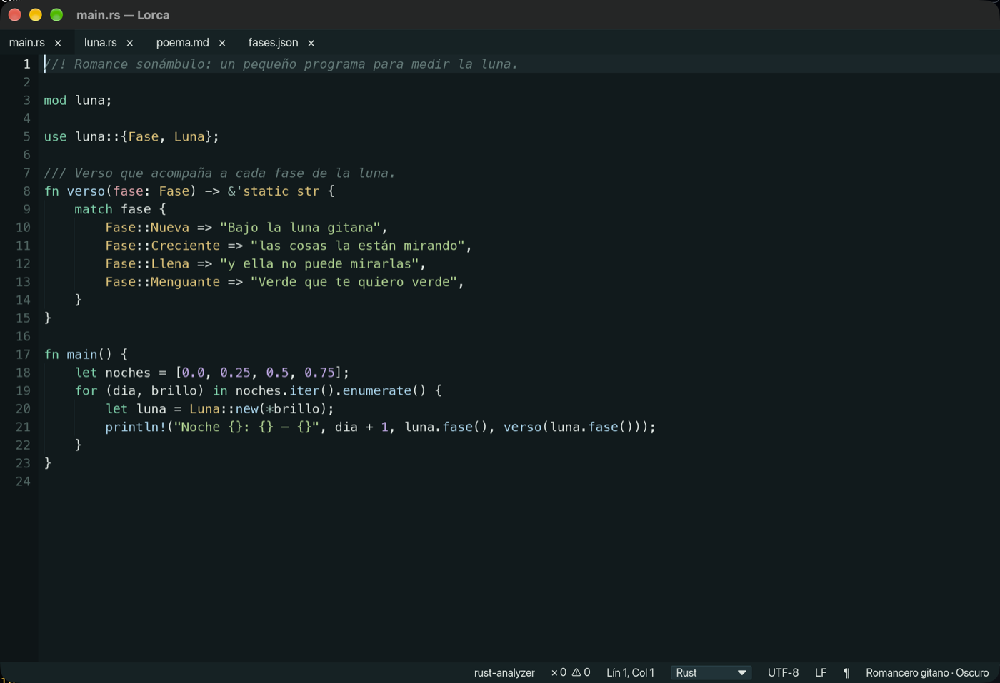
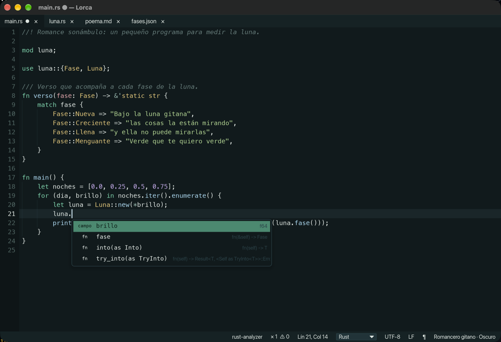
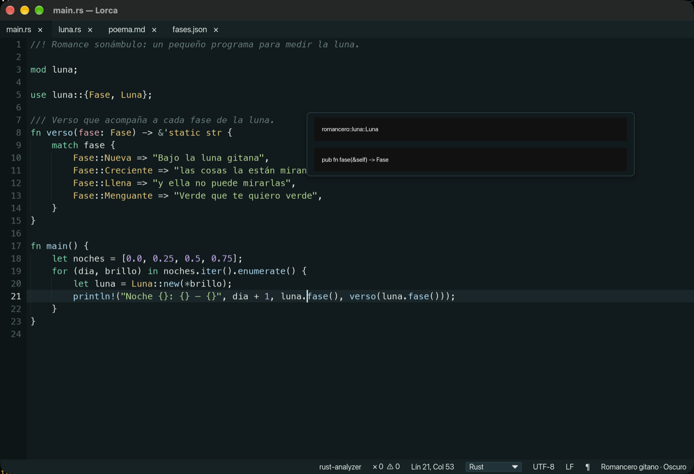
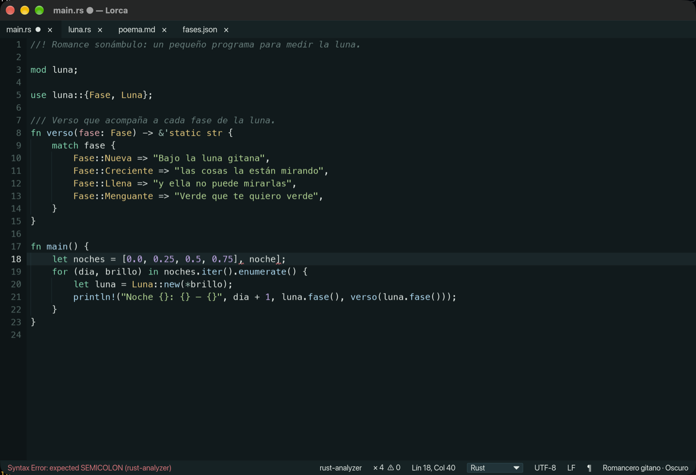
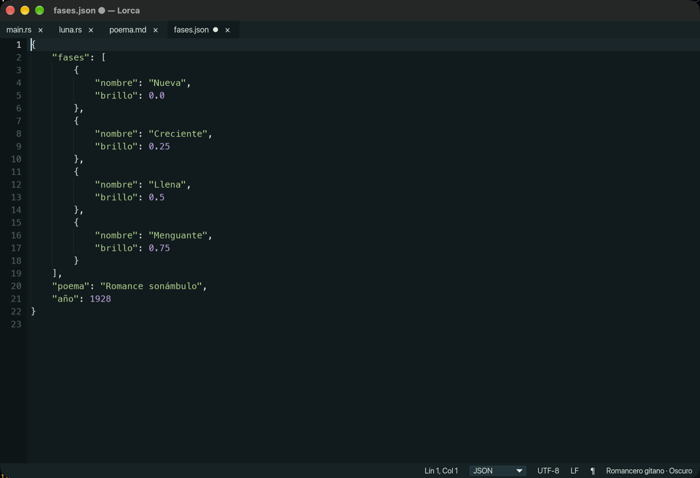
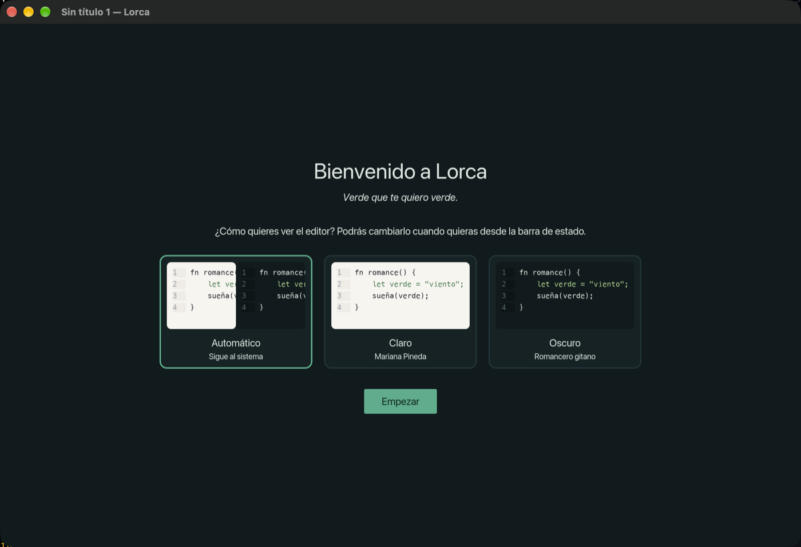

# Lorca

<p align="center">
  
</p>

<p align="center"><em>Verde que te quiero verde.</em></p>

Lorca es un editor de texto y código de escritorio para macOS, Windows y Linux, escrito en
Rust con [iced](https://iced.rs). El nombre es un homenaje a Federico García Lorca: sus
temas de color llevan los títulos de sus obras.

Pensado para tomar notas y programar: resaltado de sintaxis, autocompletado y
diagnósticos con servidores de lenguaje (LSP), búsqueda al estilo Notepad++, multicursor,
pantalla dividida, vista previa de Markdown y una sesión que nunca pierde lo que escribiste.



## Funciones

### Programar con ayuda del servidor de lenguaje

Lorca habla el *Language Server Protocol*: con un servidor instalado (rust-analyzer,
pyright, typescript-language-server…) ofrece **autocompletado** mientras escribes,
**información** del símbolo con ⌘I, **ir a la definición** con F12 o ⌘+clic y
**diagnósticos** subrayados, con el mensaje en la barra de estado y F8 para recorrerlos.







### Edición

- **Pestañas** con indicador ● de cambios, reordenables arrastrando; selección de varias
  con ⌘/Ctrl+clic para cerrarlas, guardarlas o verlas juntas. Las que no se han guardado
  llevan el comienzo de su texto, como en el Bloc de notas.
- **Pantalla dividida** de 2 a 4 documentos lado a lado (`⌘\`), cada uno con su cursor.
- **Multicursor**: ⌥+clic, ⌘D para la siguiente aparición, ⌥⌘↑/↓ en columna.
- **Deshacer por transacciones** (una palabra se deshace de una vez), números de línea,
  guías de indentación, espacios y finales de línea visibles.
- **Paleta de órdenes** (⇧⌘P) con búsqueda difusa sobre todas las acciones.
- **Menú contextual** en el texto y las pestañas; **barra de menús** nativa en macOS y
  dibujada en la ventana en Windows y Linux.

### Lenguajes y formato

- **Resaltado** con tree-sitter para Rust, Python, JavaScript, TypeScript/TSX, JSON,
  YAML, TOML, HTML, CSS, Bash, SQL y Markdown (incluidos los bloques de código).
- **Detección** por extensión, nombre de archivo y shebang (y por el contenido al pegar
  en un documento sin lenguaje); selector manual en la barra de estado.
- **Formato como en el Bloc de notas de Windows 11**: barra con títulos, listas, negrita,
  cursiva, tachado, vínculos, tablas y borrar formato (⌘B, ⌘I, ⌘K, ⇧⌘8, ⇧⌘7). Los
  documentos de **texto con formato** (Markdown, `.md`) se editan **viendo el formato**
  (títulos grandes, viñetas, negrita…) y se ajustan a la ventana; el **texto plano** se ve
  tal cual. Dar formato a un texto plano lo convierte en texto con formato.
- **Formatear** JSON y SQL (⌥⌘L), minificar JSON, MAYÚSCULAS / minúsculas / Tipo Título.
- **Vista previa de Markdown** en vivo junto al editor (⇧⌘V) y **exportación a PDF**.



### Búsqueda

- Barra de **buscar y reemplazar** con coincidencias resaltadas y contador, modos
  **Normal**, **Extendido** (`\n`, `\t`, `\xHH`…) y **Regex** con grupos (`$1`).
- **Buscar todo** en el documento, en todos los abiertos o **en una carpeta** (⇧⌘F,
  respeta `.gitignore`), con panel de resultados clicables.
- **Marcar** coincidencias y **marcadores** de línea (⌘F2, F2); **ir a línea** (⌃G).

### Archivos y sesión

- Al cerrar y volver a abrir, Lorca restaura **pestañas, cursores y cambios sin
  guardar**, sin preguntar ni tocar los archivos originales.
- Abre y guarda UTF-8 (con o sin BOM), UTF-16 y Windows-1252, y conserva LF o CRLF; ambos
  se cambian desde la barra de estado.
- **Recarga** los archivos que otro programa cambia (pregunta si tienes cambios).
- **«Abrir con Lorca»** desde el Finder de macOS y el Explorador de Windows (si Lorca ya
  está abierto, el archivo se abre en una pestaña nueva).
- **Actualizaciones automáticas**: avisa cuando hay una versión nueva y, con un clic, la
  descarga, comprueba su firma, la instala y vuelve a abrir Lorca.

### Temas con nombres de obras de Lorca

Cinco oscuros —*Romancero gitano*, *Yerma*, *Bodas de sangre*, *Poeta en Nueva York* y
*La bola negra*— y cuatro claros —*Mariana Pineda*, *La casa de Bernarda Alba*, *Doña
Rosita la soltera* y *La bola negra*—. Además, dos sin ningún color: *Blanco y negro* (claro) y
*Negro y blanco* (oscuro). Se elige uno claro y otro oscuro, y el modo automático sigue al sistema. Se
cambian desde la barra de estado o la paleta, y puedes crear los tuyos.



## Instalación

Cada versión publicada (etiqueta `vX.Y.Z`) deja en
[releases](https://github.com/gallegomanuel8/Lorca/releases) los paquetes `.dmg` (y un `.zip`
portable con el `.app`),
`.msi`/`.exe` y `.deb`/AppImage. El instalador `.exe` de Windows ofrece añadir «Abrir con
Lorca» al menú contextual de los archivos; si Lorca ya está abierto, el archivo se abre
en esa ventana. Mientras no haya ninguna, compílalo (abajo). La app
de macOS va firmada ad hoc, sin certificado de desarrollador: la primera vez que la abras
macOS dirá que no puede verificar al desarrollador; ve a Ajustes del Sistema → Privacidad y
seguridad y pulsa «Abrir igualmente».

Para el autocompletado y los diagnósticos instala el servidor de tu lenguaje, por
ejemplo `brew install rust-analyzer` o `rustup component add rust-analyzer`.

## Atajos

| Acción | macOS | Windows / Linux |
|---|---|---|
| Nuevo | ⌘N | Ctrl+N |
| Abrir | ⌘O | Ctrl+O |
| Guardar / Guardar como | ⌘S / ⌘⇧S | Ctrl+S / Ctrl+Mayús+S |
| Cerrar pestaña | ⌘W | Ctrl+W |
| Deshacer / Rehacer | ⌘Z / ⌘⇧Z | Ctrl+Z / Ctrl+Mayús+Z (o Ctrl+Y) |
| Pestaña siguiente / anterior | ⌃Tab / ⌃⇧Tab | Ctrl+Tab / Ctrl+Mayús+Tab |
| Copiar / Cortar / Pegar / Seleccionar todo | ⌘C / ⌘X / ⌘V / ⌘A | Ctrl+C / X / V / A |
| Buscar / Reemplazar | ⌘F / ⌥⌘F | Ctrl+F / Ctrl+H |
| Siguiente / anterior | F3 / ⇧F3 (o ⌘G / ⇧⌘G) | F3 / Mayús+F3 |
| Buscar la palabra del cursor | ⌘F3 | Ctrl+F3 |
| Ir a línea | ⌃G | Ctrl+G |
| Poner/quitar marcador · siguiente · anterior | ⌘F2 · F2 · ⇧F2 | Ctrl+F2 · F2 · Mayús+F2 |
| Cerrar barra de búsqueda | Esc | Esc |
| Seleccionar varias pestañas | ⌘+clic / ⇧+clic | Ctrl+clic / Mayús+clic |
| Dividir pantalla / quitar división | ⌘\ (⌘ç en teclado español) | Ctrl+\ |
| Palabra anterior / siguiente | ⌥← / ⌥→ | Ctrl+← / Ctrl+→ |
| Inicio / fin de línea | ⌘← / ⌘→ | Inicio / Fin |
| Paleta de órdenes | ⇧⌘P | Ctrl+Mayús+P |
| Buscar en carpeta | ⇧⌘F | Ctrl+Mayús+F |
| Añadir cursor · siguiente aparición · en columna | ⌥+clic · ⌘D · ⌥⌘↑/↓ | Alt+clic · Ctrl+D · Ctrl+Alt+↑/↓ |
| Vista previa de Markdown | ⇧⌘V | Ctrl+Mayús+V |
| Formatear JSON/SQL | ⌥⌘L | Ctrl+Alt+L |
| Tamaño de letra mayor · menor · normal | ⌘+ · ⌘− · ⌘0 | Ctrl++ · Ctrl+− · Ctrl+0 |
| Ajustes (`config.toml`) | ⌘, | Ctrl+, |
| Autocompletar | ⌃Espacio | Ctrl+Espacio |
| Información del símbolo | ⌘I | Ctrl+I |
| Ir a la definición | F12 o ⌘+clic | F12 o Ctrl+clic |
| Siguiente / anterior problema | F8 / ⇧F8 | F8 / Mayús+F8 |

En macOS, ⌃Espacio suele estar asignado a «Seleccionar la fuente de entrada anterior»;
si no llega a Lorca, quítalo en Ajustes del Sistema → Teclado → Atajos, o usa el menú
Código.

## Configuración

`config.toml` (en la carpeta de datos, abajo) se crea al cambiar cualquier preferencia.
Todos los campos son opcionales:

```toml
theme = "auto"                 # "auto", "light" o "dark"
light_theme = "Mariana Pineda"
dark_theme = "Romancero gitano"
font_size = 14                 # de 8 a 40
tab_width = 4                  # de 1 a 16
insert_spaces = true           # la tecla Tab inserta espacios (false: un tabulador)
show_whitespace = false
show_line_endings = false
indent_guides = true

[lsp]
enabled = true
auto_completion = true         # false: solo con ⌃Espacio

# Sustituye al servidor conocido de un lenguaje (rust, python, javascript,
# typescript, json, yaml, toml, html, css, bash, markdown).
[lsp.servers.python]
command = "pylsp"
args = []

[lsp.servers.markdown]
enabled = false                # ningún servidor para Markdown
```

Lorca guarda el archivo al cambiar preferencias desde la interfaz, así que **los
comentarios que añadas se pierden**.

### Temas propios

Un tema es un `.toml` en `themes/`, dentro de la carpeta de datos. Si se llama igual que
uno incluido, lo sustituye. Lo más fácil es partir de «Crear tema a partir del actual».

```toml
name = "Llanto por Ignacio"
appearance = "dark"            # "dark" o "light"
description = "A las cinco de la tarde"

[palette]                      # interfaz (botones, paneles, campos)
background = "#16120f"
text = "#e8dccb"
primary = "#c9a227"
success = "#7fa37a"
warning = "#e0a95a"
danger = "#d0443a"

[editor]                       # opcionales; se derivan de la paleta
selection = "#c9a22755"        # #rrggbbaa admite transparencia
cursor = "#f2d16b"
current_line = "#201a15"
# gutter, line_number, line_number_active, find, find_current, mark,
# bookmark, whitespace, guide, error, warning, info

[syntax]                       # un color o { color, bold, italic }
keyword = { color = "#c9a227", bold = true }
string = "#a8b87a"
comment = { color = "#76695b", italic = true }
# function, type, escape, number, constant, property, variable, operator,
# punctuation, tag, attribute, heading, emphasis, strong, link, code
```

### Servidores de lenguaje

Lorca usa el primer servidor instalado de esta lista para cada lenguaje (o el de
`[lsp.servers]`):

| Lenguaje | Servidor |
|---|---|
| Rust | `rust-analyzer` |
| Python | `pyright-langserver`, `basedpyright-langserver` o `pylsp` |
| JavaScript / TypeScript | `typescript-language-server` |
| JSON, HTML, CSS | `vscode-json-language-server`, `vscode-html-language-server`, `vscode-css-language-server` |
| YAML · TOML · Bash · Markdown | `yaml-language-server` · `taplo` · `bash-language-server` · `marksman` |

Se buscan en el `PATH` y en las carpetas habituales (`~/.cargo/bin`, `/opt/homebrew/bin`,
`/usr/local/bin`, `~/.local/bin`…), porque una app abierta desde el Finder no hereda el
`PATH` de la terminal. Solo funcionan con archivos guardados (el servidor necesita la
ruta). Por ejemplo, `brew install rust-analyzer` o `rustup component add rust-analyzer`.

## Datos de usuario

| Sistema | Carpeta |
|---|---|
| macOS | `~/Library/Application Support/Lorca/` |
| Windows | `%APPDATA%\Lorca\` |
| Linux | `~/.config/lorca/` |

Contiene `config.toml` (preferencias), `themes/` (temas propios), `session.toml`
(pestañas) y `backups/` (texto sin guardar). La variable de entorno `LORCA_DATA_DIR` permite usar otra carpeta.

## Compilar y ejecutar

Requisitos: Rust estable (1.85 o posterior, edición 2024).

En Linux hacen falta además las bibliotecas de desarrollo de X11/Wayland y
`xdg-desktop-portal` para los diálogos nativos.

```bash
cargo run --release                     # abre un documento nuevo
cargo run --release -- notas.md main.rs # abre archivos en pestañas
cargo test --workspace                  # pruebas
```

### Paquetes

Con [cargo-packager](https://github.com/crabnebula-dev/cargo-packager)
(`cargo install cargo-packager --locked`):

```bash
cd crates/app
cargo packager --release                     # formatos por defecto de la plataforma
cargo packager --release --formats app,dmg   # macOS
cargo packager --release --formats nsis,wix  # Windows (.exe y .msi)
cargo packager --release --formats deb,appimage
```

Los paquetes quedan en `target/packages/`. La app de macOS se firma ad hoc (la release usa
un certificado Developer ID y la notariza si el repositorio tiene los secretos de Apple;
ver `CLAUDE.md`). Los iconos están en `assets/icons/`.

### Integración continua

`.github/workflows/ci.yml` comprueba formato, clippy y tests en macOS, Windows y Linux en
cada push. Al publicar una etiqueta (`git tag v0.1.0 && git push --tags`),
`release.yml` genera los paquetes de los tres sistemas y los adjunta a una release en
borrador.

## Arquitectura

Workspace de Cargo:

| Crate | Responsabilidad |
|---|---|
| `crates/core` (`lorca-core`) | Buffer (ropey), selección, ediciones, deshacer/rehacer, codificaciones y finales de línea. Sin GUI. |
| `crates/syntax` (`lorca-syntax`) | Detección de lenguaje y resaltado con tree-sitter. |
| `crates/search` (`lorca-search`) | Buscar y reemplazar: modos, opciones, navegación y sustitución. |
| `crates/formats` (`lorca-formats`) | Formateadores JSON/SQL, mayúsculas, Markdown a HTML y a PDF. |
| `crates/workspace` (`lorca-workspace`) | Documentos abiertos, pestañas, guardado, sesión, configuración y temas. |
| `crates/lsp` (`lorca-lsp`) | Cliente del Language Server Protocol. Sin GUI. |
| `crates/app` (`lorca`) | Binario con la GUI en iced: dibuja y traduce eventos a órdenes. |

## Hoja de ruta

1. **MVP** ✅: workspace, núcleo de edición, pestañas, guardar/abrir, atajos.
   - **1.5** ✅: sesión persistente con cambios sin guardar y tema claro/oscuro/automático.
2. **Lenguajes** ✅: detección por extensión y shebang, selector manual en la barra de
   estado, resaltado de sintaxis.
3. **Búsqueda** ✅: barra buscar/reemplazar con modos Normal/Extendido/Regex, resaltado de
   coincidencias, siguiente/anterior, reemplazar todo, buscar todo con panel de
   resultados, marcar y marcadores de línea; ir a línea.
   - **3.5** ✅: menú contextual, selección de varias pestañas y pantalla dividida (2–4).
4. **Formato** ✅: caracteres invisibles, guías de indentación, conversión LF/CRLF, otras
   codificaciones, vista previa de Markdown, formatear SQL y JSON, mayúsculas/minúsculas.
5. **Productividad** ✅: multicursor, paleta de órdenes, búsqueda en carpeta, reordenar
   pestañas arrastrando, recarga si el archivo cambia en disco, menús nativos (macOS) y
   exportar Markdown a PDF.
6. **Avanzado** ✅: cliente LSP, temas («Yerma», «Bodas de sangre», «Romancero gitano»…),
   configuración en TOML, empaquetado y CI para los tres sistemas.

## Licencia

MIT o Apache-2.0, a tu elección.
